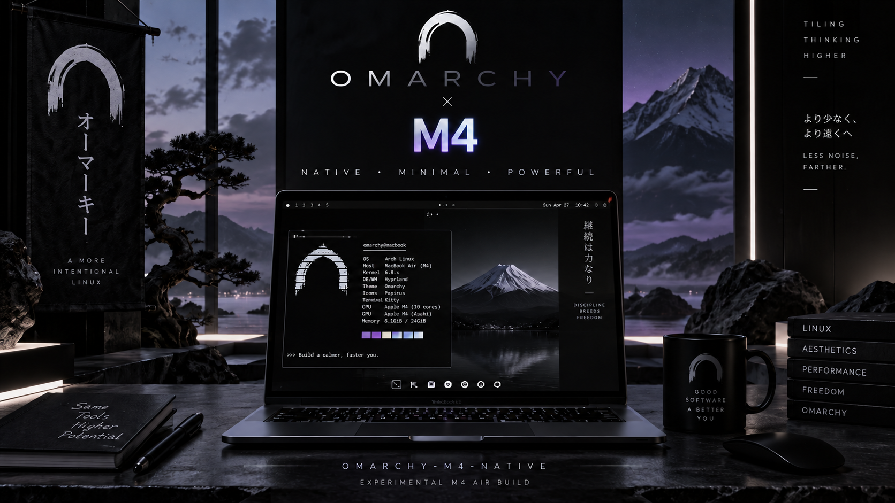

# ⚠️ EXPERIMENTAL — USE AT YOUR OWN RISK

> [!WARNING]
> **This is experimental software with unfinished hardware support and known bugs.**
> Installing, updating or running it can cause **hardware damage, data loss or
> corruption, boot failures, and loss of access to macOS**. Keep backups and a
> working recovery path. You are responsible for your installation and recovery.
>
> **This is an independent community project. It is not an official release and
> is not sponsored, approved or endorsed by Omarchy / Basecamp, Asahi Linux,
> Gravity Linux, Apple, or the other upstream projects whose work it uses.**
> Upstream credits and project names do not imply endorsement or support for
> this build.
>
> **Provided “AS IS,” without warranty of any kind, express or implied. To the
> maximum extent permitted by applicable law, the maintainers and contributors
> are not liable for hardware damage, data loss, loss of use, recovery costs, or
> other damages arising from installing, updating or using this project.**
> The applicable [licenses](LICENSE.md) and
> [third-party notices](THIRD_PARTY_NOTICES.md) remain in effect.

# 📣 Start here: new install, or updating the alpha

> [!IMPORTANT]
> ## New to Omarchy on the M4 Air
>
> [Download and install v0.1.0-alpha.1](#download-and-install), then do the
> [connect step](#then-connect-to-m4-updates--everyone-once) once after your
> first login. The published installer does not connect by itself yet.
>
> ## Already installed the alpha (including last night)
>
> **No new installer and no reinstall.** Join Wi-Fi, open a terminal on the Air,
> paste this one line, press Enter and type your password when asked:
>
> ```bash
> curl -fsSL --retry 5 --retry-all-errors https://github.com/Kb2uka/Omarchy-M4-Native/releases/download/packages/m4-connect.sh | bash
> ```
>
> - It ends with **`restart once to apply the update`**: restart the Air. That is all.
> - It ends with **`future M4 fixes arrive with omarchy-m4-update`**: you are done.
>
> This one line is the same whether you connected last night or never did. It
> brings every M4 fix so far: shutdown, CPU scaling and temperature, WebKit app
> sound and the speaker startup fix. It checks the setup script against its
> published checksum before running it; to inspect each file first, use the
> [step-by-step version](docs/updates.md#step-by-step-instead).
>
> ## Every update after that
>
> Run **`omarchy-m4-update`** in a terminal and restart if it asks. A
> **"M4 update available"** notification tells you when one is ready. It updates
> only the M4 packages; your browser, video, Widevine, speaker and trackpad setup
> are not touched. `omarchy update` updates the whole system as well, which is
> not yet qualified on this hardware. If `omarchy-m4-update` is not found, run
> the one line above once more.
> [What it does, messages and rollback](docs/updates.md).



# Omarchy on Apple M4 — experimental

**Experimental on M4 Air. Very experimental on all other M4 machines.**

Only the **13-inch M4 MacBook Air (2025), Mac16,12 / J713 / T8132**, has been
hardware-tested and qualified for this project's installer profile. Other M4
Air models, Mac mini, iMac, MacBook Pro, M4 Pro and M4 Max are **not qualified**
by these results. “Very experimental” does not mean their installation works;
the J713 installer must refuse unsupported boards.

Project integration and original contributions by **studioxradio aka kb2uka**.
Built on the work of Asahi Linux, Gravity Linux, Omarchy and many other upstream
contributors. Their authorship and licenses remain theirs.

## Download and install

**[v0.1.0-alpha.1 installer, update 4](https://github.com/Kb2uka/Omarchy-M4-Native/releases/tag/v0.1.0-alpha.1-update.4)**,
based on **Omarchy 4.0.4**. Its image starts the GPU on every 13-inch M4 Air,
including the base model's eight-core GPU
([#118](https://github.com/Kb2uka/Omarchy-M4-Native/pull/118)). It ships the
speaker filters in the image, carries the boot fix for Airs that stop on the
m1n1 logo ([#82](https://github.com/Kb2uka/Omarchy-M4-Native/issues/82)) and
connects to M4 updates by itself. No fresh installation from this exact kit has
been confirmed yet; [update 3](https://github.com/Kb2uka/Omarchy-M4-Native/releases/tag/v0.1.0-alpha.1-update.3)
remains available. Download the release's `download-j713.command` and run it
from macOS Terminal:

```sh
bash "$HOME/Downloads/download-j713.command"
```

The downloader reassembles the installer and verifies the release checksums.
Then follow the **[step-by-step installation guide](docs/install.md)**. This
installer starts in macOS; it is not a bootable PC ISO. GitHub's automatic
“Source code” ZIP is not the installer.

### Then connect to M4 updates — everyone, once

**Every install from update 2 or earlier needs this once, whether you installed
today or earlier.** It turns on M4 updates and, if your Air does not have it yet,
the shutdown fix. Updates 3 and 4 do it by themselves after first login, once the Air is
online ([details](docs/install.md#last-step-connect-to-m4-updates-required)).

1. On the Air, join Wi-Fi (`nmtui`) and open a terminal in Omarchy.
2. Paste this one line, press Enter, and type your password when asked:

```bash
curl -fsSL --retry 5 --retry-all-errors https://github.com/Kb2uka/Omarchy-M4-Native/releases/download/packages/m4-connect.sh | bash
```

3. If it ends with `"status": "connected; restart once to apply the update"`,
   **restart the Air.** If it ends with
   `"status": "connected; future M4 fixes arrive with omarchy-m4-update"`, you are done.

If it prints `FAILED` or `omarchy-m4-setup: refused: …`, stop and
[open an issue](https://github.com/Kb2uka/Omarchy-M4-Native/issues); your Air
keeps booting as before. No reinstall, and your files are not touched.
After this, run `omarchy-m4-update` for new M4 fixes; a
"M4 update available" notification tells you when one is ready.
[Details, messages and rollback](docs/updates.md).

Two attended private installations reached the desktop. A later October 12
candidate completed account setup but failed graphics and audio startup, leaving
no desktop and no automatic recovery login. Its saved boot logs identified
unrelated device waits as fatal prerequisites. The replacement corrects those
startup dependencies, enables an authenticated recovery console, and keeps
kernel messages from displacing the setup form. **The replacement still needs
an attended installation before publication.** Intermittent trackpad AFE startup
remains unqualified; shutdown needs the [connect step](#then-connect-to-m4-updates--everyone-once). See the [startup repair record](docs/j713-first-boot-recovery.md),
[qualification record](docs/experimental-release.md) and
[known limitations](docs/release-limitations.md).

**M4 updates are signed packages** from this project's `[omarchy-m4]`
repository ([how it works](docs/package-channel.md)), delivered by
`omarchy-m4-update` after the connect step. A push to `main` does not update
installed machines; only packages published to the channel do. General
Arch Linux ARM and Omarchy updates remain unqualified on this hardware; read the
[update guide](docs/updates.md) before accepting them.

### What M4 updates bring

After the connect step, `omarchy-m4-update` keeps these current, and restarting
once applies them:

| Fix | Since |
| --- | --- |
| Shut Down turns the Air off ([#48](https://github.com/Kb2uka/Omarchy-M4-Native/pull/48)) | `omarchy-m4-boot` 1-1 |
| CPU frequency scaling on all ten cores ([#55](https://github.com/Kb2uka/Omarchy-M4-Native/pull/55)), with the real-time speaker protection it needs | `omarchy-m4-boot` 1-4 |
| CPU die temperature in Linux ([#62](https://github.com/Kb2uka/Omarchy-M4-Native/pull/62)) | `omarchy-m4-boot` 1-4 |
| Speaker protection starts reliably at boot ([#61](https://github.com/Kb2uka/Omarchy-M4-Native/pull/61)); applied at the next boot ([details](docs/j713-protection-startup.md#existing-installs)) | `omarchy-m4-speaker` 1-1 |
| Sound in Zeus Link and other WebKitGTK and GStreamer apps ([#54](https://github.com/Kb2uka/Omarchy-M4-Native/pull/54), [#63](https://github.com/Kb2uka/Omarchy-M4-Native/pull/63)) | `omarchy-m4-gst-audio` 1.28.7-1 |
| GPU and desktop on Airs whose GPU power limit is below 24800 mW ([#57](https://github.com/Kb2uka/Omarchy-M4-Native/issues/57)); applied at the next boot | `omarchy-m4-gpu` 1-1 |
| GPU and desktop on base-model Airs with the eight-core GPU ([#118](https://github.com/Kb2uka/Omarchy-M4-Native/pull/118)); applied at the next boot | `omarchy-m4-gpu` 1-3 |
| Headphone jack playback ([#88](https://github.com/Kb2uka/Omarchy-M4-Native/pull/88)); starts at the next boot ([details](docs/j713-headphones.md#existing-installs)) | `omarchy-m4-headphones` 1-1 |
| CPU idle: idle cores power down, so the idle Air runs cooler and draws less ([#65](https://github.com/Kb2uka/Omarchy-M4-Native/issues/65)); starts at the next boot ([details](docs/j713-cpu-idle.md#existing-installs)) | `omarchy-m4-cpu` 1-1 |
| E cores up to 2172 MHz and a CPU die thermal safety net ([#66](https://github.com/Kb2uka/Omarchy-M4-Native/issues/66)) | `omarchy-m4-boot` 1-10 |
| P cores boost up to 4464 MHz and E cores up to 2808 MHz under a predictive heat guard ([#66](https://github.com/Kb2uka/Omarchy-M4-Native/issues/66)); starts at the next boot, off switch `sudo m4-cpu-idle --boost off` ([details](docs/j713-cpu-boost.md#existing-installs)) | `omarchy-m4-boot` 1-11, `omarchy-m4-cpu` 1-2 |
| The boost guard's limits match macOS on the fanless Air (105 C bursts, 100 C sustained), so one busy core runs at its top boost (4.04 GHz, bursts to 4.46 GHz) for most of a 45 s job, and it estimates the die's temperature from heat measured on the Air ([#66](https://github.com/Kb2uka/Omarchy-M4-Native/issues/66), [details](docs/j713-cpu-boost.md#settled-heat-the-base-estimate)) | `omarchy-m4-cpu` 1-3 |
| Headset microphone on the headphone jack ([#105](https://github.com/Kb2uka/Omarchy-M4-Native/pull/105)); starts at the next boot ([details](docs/j713-headphones.md#headset-microphone)) | `omarchy-m4-headphones` 1-2 |
| Opt-in: the desktop uses the whole 2560x1664 panel, with the bar's widgets left and right of the camera ([#89](https://github.com/Kb2uka/Omarchy-M4-Native/issues/89)); `sudo m4-notch --show`, then restart; `sudo m4-notch --hide` goes back ([details](docs/j713-notch.md)) | `omarchy-m4-boot` 1-12 |
| External monitors through DisplayLink USB adapters and docks. **One extra step, once:** `yay -S displaylink`, then `sudo systemctl enable --now displaylink.service` (Synaptics' DisplayLinkManager is closed source, so the update cannot ship it). Plain USB-C to HDMI/DisplayPort adapters, USB-C and Thunderbolt monitors, and Thunderbolt dock display ports still do not work ([#58](https://github.com/Kb2uka/Omarchy-M4-Native/issues/58), [details](docs/j713-external-displays.md)) | `omarchy-m4-evdi` 1.15.1-1, `omarchy-m4-boot` 1-13 |

A devicetree you applied by hand from the guides is kept; the update never
moves an Air back to an older one. An Air connected before
`omarchy-m4-gst-audio` was published gets it by running the connect line once
more.

Nothing on this list is a manual step any more.

## Shutdown

**Shut Down works once the Air is connected to M4 updates (or has update 1):**
the Air turns off and stays off. Verified on the test Air on October 12, 2026.
alpha.1 without the fix restarted instead, so run the
[connect step](#then-connect-to-m4-updates--everyone-once) if you haven't.
[What was wrong and how it was fixed](docs/j713-poweroff.md) ·
[issue #24](https://github.com/Kb2uka/Omarchy-M4-Native/issues/24) (closed).

## What has been observed on the test Air

As of October 11, 2026, with the pinned experimental runtime:

| Area | Observed result and limit |
| --- | --- |
| Installed desktop | Two private installer trials reached the desktop; the second required a restart after setup stalled. The final owner-input packaging and general updates remain unqualified. |
| Keyboard, trackpad, Wi-Fi | Used in the native desktop. These observations do not qualify every peripheral or power state. |
| Bluetooth | A paired mouse reconnected after an observed reboot. General Bluetooth audio and every device are not qualified. |
| Shut Down | With update 1, Shut Down turns the Air off and it stays off; the next power-on boots normally (October 12). |
| Graphics | Experimental Apple M4 GPU rendering is active. Scanout still uses simpledrm; this is not complete display-controller support or proof of physical panel timing. |
| Speakers | Protected internal-speaker playback and automatic startup have worked on the test Air. Broad acoustic calibration, all failure conditions and suspend/resume remain unqualified. |
| Headphone jack | With `omarchy-m4-headphones` from `omarchy-m4-update` (October 14-15, 2026): clean stereo playback beside the protected speakers, and the output follows plug and unplug. Headset microphone with `omarchy-m4-headphones` 1-2 (October 15): clean mono capture, alone and during playback, a clean two-way video call, and input that follows plug and unplug. Suspend/resume is not supported. |
| Browser video | H264 8-bit and VP9 Profile 0 hardware decoding have been observed with the qualified decoder/graphics stack. Ordinary 1080p30 playback works in the tested cases. This is not hardware support for every codec or protected video. |
| Normal media-player launch | A 10-second normal mpv file-open check used `vaapi-copy` with zero reported frame/decoder drops; an AV1 control reached EOF in software with one startup frame drop. `vaapi-copy` still uses the hardware decoder, with a copy into CPU-accessible memory afterward. |
| Protected movies | A tested Widevine movie used CPU decoding and played. Hardware decoding is not promised for protected content, and no license or DRM restrictions are bypassed. |
| Known video issue | A tested 1080p60 browser video dropped roughly 47% of frames in a normal window; the fullscreen comparison reported 1 drop in 1,804 frames. This geometry-dependent problem remains open. Fullscreen is a tested discriminator, not a universal fix. |
| USB-C ports | The hinge-side port works in alpha.1. With `omarchy-m4-boot` 1-12 from `omarchy-m4-update`, the front port works too: the same SuperSpeed drive enumerated and read cleanly on both (October 16). Alternate modes and broad peripheral coverage are not qualified. |
| External displays | A USB-C or Thunderbolt monitor shows nothing: the M4's display coprocessor (DCP) firmware is not supported by Linux yet. With `omarchy-m4-evdi`, Hyprland drew a virtual DisplayLink-style monitor at 60 Hz (October 17); no physical DisplayLink adapter is qualified yet ([details](docs/j713-external-displays.md)). |
| Camera, suspend/resume, battery life | Not qualified for release. |

These are observations from one machine and specific builds, not a statement
about current upstream Asahi support or every M4 system. Good decoder counters
do not by themselves establish physical smoothness, color accuracy or audibility.
The current desktop integration restricts only the compositor's main thread to
the measured performance-core set; browser/decoder worker threads remain
unrestricted. Do not substitute the older broad session-placement experiment.

## Release scope

The download includes the installer, image, checksums, source archives and
upstream notices. Updates 3 and 4 carry the speaker filters in the image; the
update 2 kit instead prepared them from the owner's installed macOS before
partitioning. The release assembler includes the exact approved
[static J713 profile](audio/j713/filters/README.md) in the root image. Apple components, Widevine binaries and preset
personal consent remain excluded.

The camera, suspend/resume, broad hardware coverage
and coordinated updates remain open work. This alpha is not a daily-driver,
safe-update or all-M4 compatibility promise. See the
[source package guide](docs/release-source.md) for source/build boundaries.

## Source and historical research

| Path | Purpose |
| --- | --- |
| [Experimental release boundary](docs/experimental-release.md) | Current qualification, provenance and publication limits |
| [Desktop image preparation](docs/j713-desktop-image.md) | Existing offline root/owner configuration, including qualified main-thread startup placement |
| [J713 installer profile](docs/j713-installer-profile.md) | Recovery/firmware/board checks for the experimental installer profile |
| [SSD root preparation](docs/j713-ssd-root-preparation.md) | Root identity, boot payload and owner provisioning work |
| [GPU and normal-root checkpoint](docs/j713-gpu-normal-root.md) | Historical October 8 RAM-root evidence |
| [Hardware gap analysis](docs/t8132-gap-analysis.md), [ADT audit](docs/t8132-adt-audit.md) | Source-derived mappings, uncertainties and historical tests |
| [patches/](patches/), [patches-kernel/](patches-kernel/) | Changes against specific historical bases; not a patch set for any current kernel |
| [tools/](tools/), [tests/](tests/) | Source helpers and offline regression checks |
| [recon/](recon/), [SPEC.md](SPEC.md) | Capture availability and the original roadmap, not current support promises |

Read the date and stated limits in older notes. Their failed attempts and
bring-up workarounds are retained for provenance; they are not current installer
instructions. Raw hardware captures, browser profiles, credentials and native
session logs remain outside the source tree. A clone is not a complete boot kit.

## Credits and licensing

**studioxradio aka kb2uka** maintains this integration and contributed the
project-specific research, fixes and packaging. Existing copyright notices using
KB2UKA are retained. The project does not claim upstream work as original.

- [Asahi Linux](https://asahilinux.org/) and [m1n1](https://github.com/AsahiLinux/m1n1): Apple Silicon research, boot and driver foundations.
- [Gravity Linux](https://github.com/GravityLinux): M4 kernel/installer groundwork used by this experiment, building on Asahi's work.
- [Omarchy](https://github.com/basecamp/omarchy) and [omarchy-mac](https://github.com/omacom/omarchy-mac): desktop and integration work.
- Linux, Mesa, PipeWire, WirePlumber, ALSA, speakersafetyd, mpv and the other
  dependencies retain their respective contributors' copyrights and licenses.
  The historical AIC investigation also records Yureka's M4 work.

This is an independent experiment, not an official release or endorsement by
Apple or any upstream project. The artwork is concept art, not a system screenshot.
See [LICENSE.md](LICENSE.md), [THIRD_PARTY_NOTICES.md](THIRD_PARTY_NOTICES.md) and
[LICENSES/](LICENSES/) for the mixed-license scope. No project license grants
rights to Apple firmware, macOS, Widevine, trademarks, unlicensed captures or
separately obtained assets.
